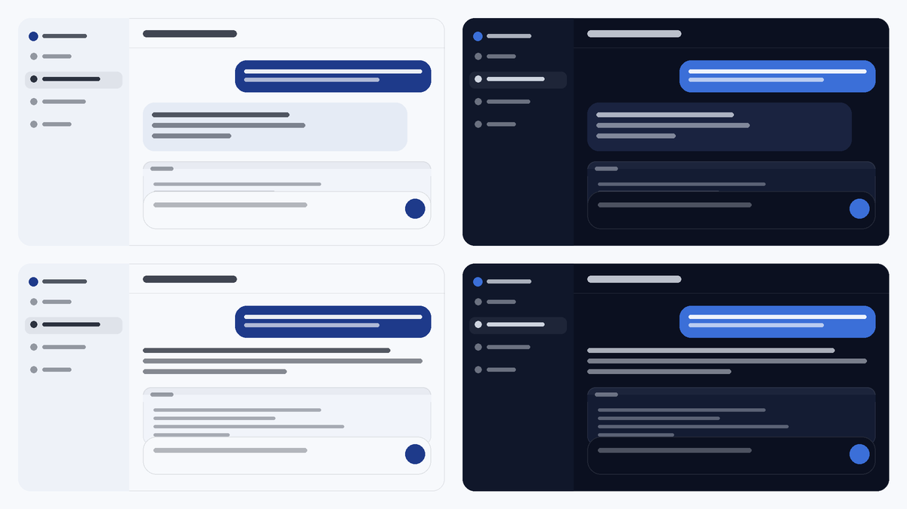

# dsh-moonstyle

给 **DeepSeek Harness（DSH）** 用的月光主题：冷白偏蓝的浅色、深海军蓝的深色、圆润字体，强调色一个都不改。除了配色，还顺手把侧栏按 ds-bot 的样子减负——空白的左上角、贴边的小齿轮、能调的标题长度、能关掉的时间戳、上下键切会话。

> 为「性能敏感」而做。常见的主题插件会叠壁纸层、毛玻璃、常驻 DOM 观察器，持续吃 GPU 和电；这个插件反过来：**重算一张样式表就完事，没有定时器、没有 `backdrop-filter`，唯一的观察器只在设置面板打开时存在。**



*配色渲染示意，不是应用截图。上排气泡形态、下排会话形态；左列浅色、右列深色。*

---

## 功能

设置侧栏里多了独立的一栏「**月光**」，七个控件全部实时生效。

| 控件 | 选项 | 作用 |
|---|---|---|
| **消息形态** | 气泡 / 会话 | 助手回复套不套圆角面板（你的消息始终是靛蓝底白字） |
| **配色** | 月光 / 原生 | 切换到 DSH 原厂色板，随时对比 |
| **侧栏装饰** | 显示 / 精简 | 精简 = 左上角整块清空、左下角头像换成贴边齿轮 |
| **正文字重** | 0–100 无级 | 正文笔画厚薄，只加墨，不改字号与排版 |
| **侧栏字重** | 0–100 无级 | 侧栏文字的笔画厚薄，与正文分开调 |
| **侧栏标题长度** | 4–12 字无级 | 会话名显示到第几个字，超出省略号 |
| **侧栏时间** | 隐藏（默认）/ 显示 | 空闲行那串「刚刚 / 5分钟」；进行中、待回答等状态始终显示 |
| **恢复默认顺序** | 按钮 | 把设置侧栏那列放回原生顺序 |

另外四件事不用设置：

- **设置侧栏那一列可以拖着换顺序**：按住任意一栏（账号、通用、模型……包括「月光」）上下拖，松手即生效，下次打开还是你排的样子。记住的是栏目 id 不是文字，所以换界面语言不会错位；新装的插件不会被挤掉，自动排在后面。存 `localStorage`，只影响这一台机器。
- **侧栏分两级字号**：分组上方的文件夹/项目名是 16px 半粗，会话名保持 14px 正文字号——一眼能看出哪行是标题、哪行是内容。
- **点侧栏「工作区」两个字 → 已归档会话直接铺开**（再点收起），且自动点掉「展开其余 N 个」把每组撑满。
- **`↑` / `↓` 切换会话**，到顶再按 `↑` 回到最下面、到底再按 `↓` 回到最上面，正文不再跟着方向键滚动。输入框有内容、弹窗/菜单打开、带修饰键时自动交还。

## 为什么用它

**轻。** 一套主题通常意味着持续的 GPU 开销，这里几乎没有：

| 项目 | 数值 |
|---|---|
| 注入的 `<style>` | **1 个**（内容就地重写，不增不减） |
| `MutationObserver` / `ResizeObserver` | 设置面板打开时 1 个，关闭即断开 |
| `setTimeout` / `setInterval` / `requestAnimationFrame` | 无 |
| `backdrop-filter` | 无 |
| 宿主侧逻辑 | 0 行 |
| 偏好存储 | 2 个 `localStorage` 键，只写不轮询 |

**无级，不是三档。** 中文常用的 PingFang 不是可变字体，`font-weight: 450` 只会跳到 400 / 500 / 600，而「无级」两个字就是假的。这里用 `-webkit-text-stroke` 给文字加墨——连续值、不触发重排、不改字号行高。正文和侧栏两根滑杆互不干扰。

**配色克制。** 只动表面色和文字灰阶两层；按钮、链接、焦点环、成功/警告/错误、diff、品牌色、滚动条全部沿用 DSH 原生。正文字体面积对比度浅色 16.81:1、深色 16.13:1；最紧的一处是深色模式下你的气泡（白字 on `#3b6fd8`）4.72:1，仍过 AA。

**跟 ds-bot 共存。** 不用 token 层写颜色，改用带 `!important` 的样式表——能压过 ds-bot 和 ui-layout 的 inline style。「原生」也不是"停止注入"（那样 ds-bot 的月光值会露出来），而是把 DSH 原厂 token 用同等优先级写回去。

## 安装

一条命令，从 GitHub 直装（pnpm 拉取，`dsh` 会自动登记 bundle）：

```bash
dsh plugin --profile desktop add github:JokesLin/dsh-moonstyle
```

`desktop` 换成你自己的 profile 名（`ls ~/.dsh/profiles` 可以看到）。不放心移动的分支，可以钉死提交：

```bash
dsh plugin --profile desktop add github:JokesLin/dsh-moonstyle#<commit-sha>
```

**手动装。** 在 profile 的 `package.json`（通常是 `~/.dsh/profiles/<名字>/package.json`）里加依赖并登记 bundle：

```json
{
  "dependencies": {
    "dsh-moonstyle": "link:/绝对路径/到/dsh-moonstyle"
  },
  "dsh": {
    "profile": {
      "bundles": ["…", "dsh-moonstyle"]
    }
  }
}
```

改完重启 DSH 或重载 Web UI。`cordis.patch.yml` 里还带了一条宿主侧配置：AI 生成的会话标题上限 12 个汉字（36 字节）——这条需要重启才生效，且对手动重命名同样有效；不想要删掉那两条 `- id:` 即可。

## 想自己改

| 想改什么 | 改哪里 |
|---|---|
| 整体色调 | `MOON` 色卡（light / dark 各 9 个键） |
| 你的气泡颜色 | `MOON.*.user` / `MOON.*.userInk` |
| 「原生」写回的值 | `STOCK` 常量 |
| 字体 | `FONT_ROUNDED` |
| 字重上限 | `STROKE_MAX`（滑杆 100 时的描边宽度） |
| 标题长度上限 | `TITLE_CHARS_MIN` / `TITLE_CHARS_MAX` + 补丁里的 `maxTitleBytes` |
| 点击「工作区」的行为 | `toggleArchived()` 与两条菜单文案正则 |
| 消息形态规则 | `layoutCss()` |
| 侧栏精简范围 | `chromeCss()`（齿轮是内联的 `GEAR`） |
| 设置侧栏的拖拽 | `installNavDrag()` / `paintNav()`；行 id 靠 `navIdsFn()` 从 `ctx.slots.entries` 对齐 |
| 插件在设置栏的位置 | `ctx.slots.register({ id: "moonstyle", order: 50 })` |
| 设置栏的图标 | `NavIcon`（手写 SVG，不依赖图标包） |

## 兼容性

- 面向 DSH 的 Cordis 客户端插件接口（`window.__ModuleLoader__` + `ctx.slots` + `ctx.theme`）。
- 浏览器半边声明在 `package.json` 的 `dsh.client`；`index.js` 为空，只作 bundle 占位。
- 设置行用 `@deepseek-ai/dsh-client-ui-primitives` 的 `SegmentedControl`，该模块缺失时降级成普通按钮，不连累插件。
- 设置侧栏的拖拽靠宿主行上那层 `[class*="_navCell"]` 的类名哈希与 `ctx.slots.entries("settings.section")` 的顺序对齐。宿主如果改了类名或打乱了注册顺序，拖拽会安静地失效——设置页本身照常能用；点「恢复默认顺序」也不会丢东西。
- 已在 DSH `0.2.2-rc.1` 与 `0.2.2-rc.2` 上核对过：18 个宿主类名、25 个主题令牌、`settings.section` / `settings.section.icon` 两个槽位与 `entries()` 的 `options.id` / `options.order` 结构都未变。rc.2 只是把 CSS Module 的类名哈希从 `_77Pn0W_` 换成了 `VOzbGW_`，前缀后的语义名（`_navCell` 等）仍在，所以子串选择器照常命中。
- `--dsw-specific-sidebar-nav-item-hover` 是我自己补的一个令牌，宿主从未定义过（rc.1 里也没有）；设置它无害，但不会有任何可见效果。
- 装了 [ds-bot](https://www.npmjs.com/package/ds-bot)（bot 模式）时，气泡的形状和文字色全部让给 ds-bot：它以 `shadow("conversation.chat.node", {key:"assistant-step"})` 接管助手消息，在里面画自己的 `.bt-bubble`，用户侧也用 `--bt-user` / `--bt-user-ink` 重绘。插件如果继续在 `assistant-step` 流程项上画面板，就会在大气泡里再套一个，逐层叠起来。
  判据是 `body[data-bt-layout]`（ds-bot 装载时写入、卸载时删除），写在 CSS 里而不是 JS 分支：ds-bot 比本插件的样式表晚挂载，构建期判断会永远看不到它。没装 ds-bot 时该属性不存在，所有规则行为与原来一致。

## 许可

[MIT](./LICENSE)
